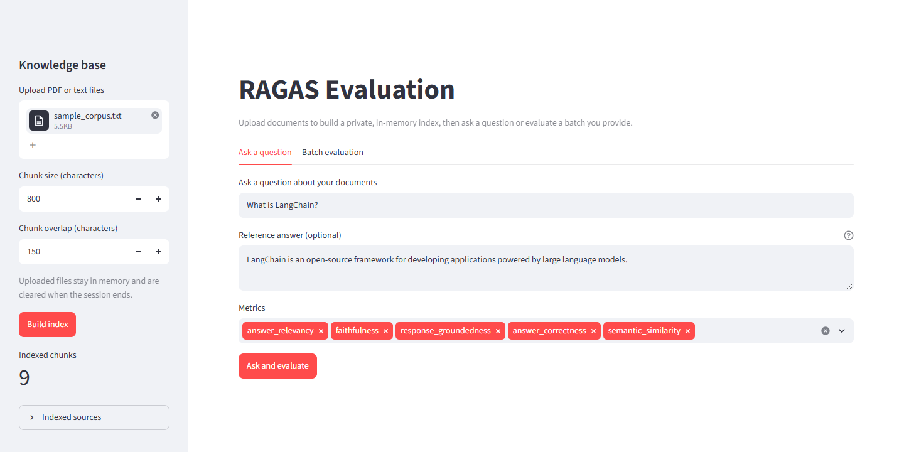
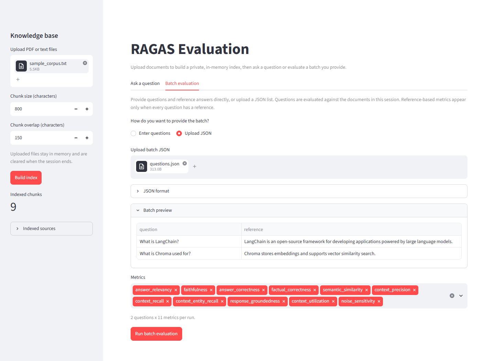

# RAGAS Evaluation

A Retrieval-Augmented Generation (RAG) project with a user-focused Streamlit app and an optional folder-based CLI.

Users can upload PDF or text files, build a private index for their session, ask questions, and score the answers with [RAGAS](https://docs.ragas.io/). Batch evaluation is supported through an editable table or a JSON upload. Answers are generated with an NVIDIA-hosted model using retrieved context.

## Features

### Web UI

- Upload multiple `.pdf` and `.txt` files.
- Build an in-memory ChromaDB index with configurable chunk size and overlap.
- Keep each user's documents, answers, and results isolated in their Streamlit session.
- Ask a single question and optionally provide a reference answer.
- Run a batch by entering question/reference rows or uploading a JSON file.
- Choose the RAGAS metrics to run.
- View the results table and three comparison charts.
- Download the results as CSV and download each chart as a PNG.
- Reuse answers and scores within the session when rerunning a batch or adding metrics.

The UI does not write uploads, results, plots, or a cache into the project. A new session starts clean.

### CLI

- Index local files from `documents/`.
- Evaluate a question/reference dataset file you provide.
- Write `ragas_results.csv`, PNG plots, and a resumable `eval_cache.json`.

## UI preview

### Ask a question



### Batch evaluation



The screenshots use the sample corpus. Documents, answers, and results stay in the Streamlit session.

## How it works

1. PDF pages and UTF-8 text files are read and split with `RecursiveCharacterTextSplitter`.
2. Chunks are embedded with `all-MiniLM-L6-v2`.
3. Embeddings are stored in ChromaDB with source and page metadata.
4. For each question, the five most similar chunks are retrieved.
5. The NVIDIA-hosted LLM generates an answer from the retrieved context.
6. The selected RAGAS metrics score the answer, context, and optional reference.
7. The app shows the results and provides CSV and PNG downloads.

The UI uses an in-memory ChromaDB client scoped to the Streamlit session. The CLI uses a persistent ChromaDB store under `db/chroma_db/`.

## Requirements

- Python **3.13+**
- An [NVIDIA API key](https://build.nvidia.com/)
- About 1 GB of free disk space for dependencies
- About 90 MB for the embedding model

Only text-based PDFs are supported. Scanned image-only PDFs must be OCR'd before upload or ingestion.

## Setup

Using `uv` (recommended, resolves from `uv.lock`):

```bash
uv sync
```

Using `pip`:

```bash
python -m venv .venv
.venv\Scripts\Activate.ps1    # Windows PowerShell
source .venv/bin/activate     # macOS / Linux
pip install .
```

Create a `.env` file from the template:

```bash
cp .env.example .env
```

On Windows PowerShell:

```powershell
Copy-Item .env.example .env
```

Add your API key:

```dotenv
NVIDIA_API_KEY=your-nvidia-api-key-here
```

## Run the web UI

```bash
uv run streamlit run app.py
```

### 1. Build an index

1. Upload one or more PDF or text files in the sidebar.
2. Adjust the chunk size and chunk overlap if needed. Defaults are 800 and 150 characters.
3. Click **Build index**.
4. Review the indexed chunk count and source file list in the sidebar.

Uploads are processed in memory. They are not saved to `documents/`, and the UI does not create a local ChromaDB collection.

Re-indexing replaces the current session's index and clears previous results and the session cache.

### 2. Ask a single question

In the **Ask a question** tab:

1. Enter a question.
2. Optionally enter a reference answer.
3. Choose metrics.
4. Click **Ask and evaluate**.

Without a reference, only metrics that do not need one are shown. The default single-question metrics are:

- `answer_relevancy`
- `faithfulness`
- `response_groundedness`

Providing a reference adds these to the default selection:

- `answer_correctness`
- `semantic_similarity`

The result includes the generated answer, retrieved contexts, metric scores, and a score chart.

### 3. Run a batch

In the **Batch evaluation** tab, choose one of two input modes.

#### Enter questions directly

Use the editable table to add question/reference rows. Completely blank rows are ignored. A row with a reference but no question shows a validation error.

#### Upload JSON

Upload a UTF-8 JSON file or download the template from the UI:

```json
[
  {
    "question": "What is the main finding?",
    "reference": "The main finding is ..."
  },
  {
    "question": "Which method was used?",
    "reference": "The method was ..."
  }
]
```

`reference` is optional. If every question has a reference, all available metrics are selected by default and reference-based metrics become available. If any question lacks a reference, reference-based metrics are hidden and the three core metrics are selected by default.

After a batch run, the UI shows:

- A results table with the answer, contexts, reference, and scores.
- A **Download CSV** button.
- An average-score chart, a per-question heatmap, and a score-distribution box plot.
- A download button for each chart.

Batch artifacts are generated in memory and downloaded directly. The UI does not write `ragas_results.csv`, `plots/`, or `eval_cache.json`.

### Session cache

The UI keeps an in-memory evaluation cache for the current Streamlit session only.

It helps when:

- A batch is rerun after a failure or timeout.
- More metrics are selected for the same questions.
- A question appears more than once in a batch.
- A reference changes: the answer can be reused, but the old metric scores are discarded.

The cache is cleared when the index is rebuilt. It is not shared between users and is lost when the session ends.

## Example batch results

The UI and CLI use the same plotting code. These images come from an example sample-corpus run; your scores will differ.

### Average score per metric


### Metric scores by question


### Score distribution per metric


## Metrics

The project uses eleven RAGAS metrics:

| Metric | What it checks | Better |
| --- | --- | --- |
| `answer_relevancy` | Does the answer address the question? | Higher |
| `faithfulness` | Is the answer supported by the retrieved context? | Higher |
| `answer_correctness` | Does the answer agree with the reference? | Higher |
| `factual_correctness` | How much factual overlap is there with the reference? | Higher |
| `semantic_similarity` | How similar are the answer and reference embeddings? | Higher |
| `context_precision` | Is the retrieved context relevant? | Higher |
| `context_recall` | Does the context cover what the reference needs? | Higher |
| `context_entity_recall` | Are the reference's entities present in the context? | Higher |
| `response_groundedness` | Is the response grounded in the retrieved context? | Higher |
| `context_utilization` | Was the useful context actually used? | Higher |
| `noise_sensitivity` | How often is the answer misled by noise? | Lower |

Scores are floats between 0 and 1. Metrics that use an LLM add API calls for every question.

## CLI usage

The CLI is a separate folder-based workflow for local development.

### Index local documents

Place `.pdf` and `.txt` files under `documents/`. Subdirectories are scanned recursively. A sample corpus is included.

```bash
uv run ingest.py
```

Useful options:

```bash
uv run ingest.py \
  --documents-dir documents \
  --chunk-size 1200 \
  --chunk-overlap 200
```

Use `--append` to keep existing chunks instead of replacing the collection:

```bash
uv run ingest.py --append
```

Use `--db-path` and `--collection` to choose the ChromaDB location and collection name. The default collection is stored in `db/chroma_db/`.

### Evaluate a dataset

Create a JSON file with your questions and reference answers:

```json
[
  {
    "question": "What is LangChain?",
    "reference": "LangChain is an open-source framework ..."
  }
]
```

Both `question` and `reference` are required in the CLI dataset. The CLI does not include a built-in dataset.

Run the evaluation with the dataset path:

```bash
uv run eval.py --dataset questions.json
```

Use `--documents-dir` to evaluate files from a different folder:

```bash
uv run eval.py --dataset questions.json --documents-dir documents
```

`eval.py` rebuilds the local index, evaluates every dataset item with all eleven metrics, and writes:

- `ragas_results.csv`
- `plots/average_metric_scores.png`
- `plots/metric_scores_by_question.png`
- `plots/metric_score_distributions.png`
- `eval_cache.json`

The CLI cache is keyed by question and metric. It is pruned when questions are removed from the dataset file. Cached answers are reused only when the retrieved contexts still match, and scores are discarded when the reference or answer changes.

## Project layout

```text
.
|-- app.py                      # Streamlit UI: uploads, single questions, batches
|-- eval.py                     # RAGAS metrics, evaluation flow, and CLI entry point
|-- ingest.py                   # CLI index builder
|-- document_loader.py          # PDF/TXT loading, chunking, and upload handling
|-- plots.py                    # Result charts
|-- llm.py                      # NVIDIA client, retries, and answer generation
|-- embeddings.py               # RAGAS embedding adapter
|-- cache.py                    # CLI cache helpers
|-- db/
|   |-- chroma.py               # ChromaDB wrapper and in-memory database factory
|   `-- embedding_func.py       # Chroma embedding function
|-- models/
|   `-- model.py                # Downloads and loads all-MiniLM-L6-v2
|-- documents/
|   `-- sample_corpus.txt       # Sample CLI corpus
|-- assets/                     # UI screenshots and example charts used in this README
|-- tests/                      # Test suite with fake models and temporary databases
|-- .streamlit/config.toml      # Streamlit settings
|-- .github/workflows/ci.yml    # Lint, format check, and tests
|-- pyproject.toml              # Dependencies and tool configuration
`-- uv.lock                     # Resolved dependency lockfile
```

## Development

```bash
uv sync

uv run ruff check .
uv run ruff format --check .
uv run pytest
```

The tests use fake models and temporary directories. They do not need an API key or a real model download. CI runs linting, formatting checks, and the test suite on every push and pull request.

## Troubleshooting

**`NVIDIA_API_KEY is missing`**
Create `.env` from `.env.example` and add a valid key.

**No text can be indexed**
The PDF may be image-only. Run OCR first. Empty text files are also ignored.

**The first run is slow**
The embedding model is being downloaded to `models/checkpoints/`. Later runs load the saved copy.

**The UI index disappeared**
The UI index is session-scoped. A new session or page refresh starts with an empty index, so upload and rebuild.

**Rate limits or timeouts**
The LLM client retries transient errors with exponential backoff. For frequent rate limits, reduce the number of metrics or wait before retrying.

## Notes

- The Streamlit app keeps uploads, vectors, answers, results, plots, and its cache in memory. Only the shared embedding model is stored locally under `models/checkpoints/`.
- The CLI keeps its ChromaDB, cache, CSV, and plots on disk.
- Streamlit's file watcher is disabled in `.streamlit/config.toml` to avoid a watcher probe for the optional `torchvision` package.
- `langchain-community` is pinned to `0.3.31` for compatibility with RAGAS 0.4.3.
