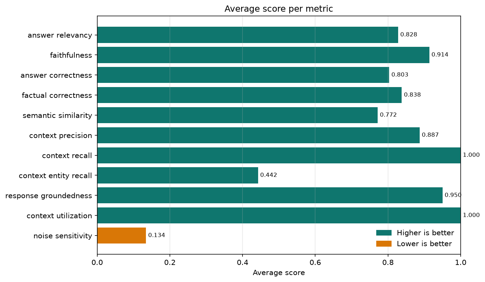
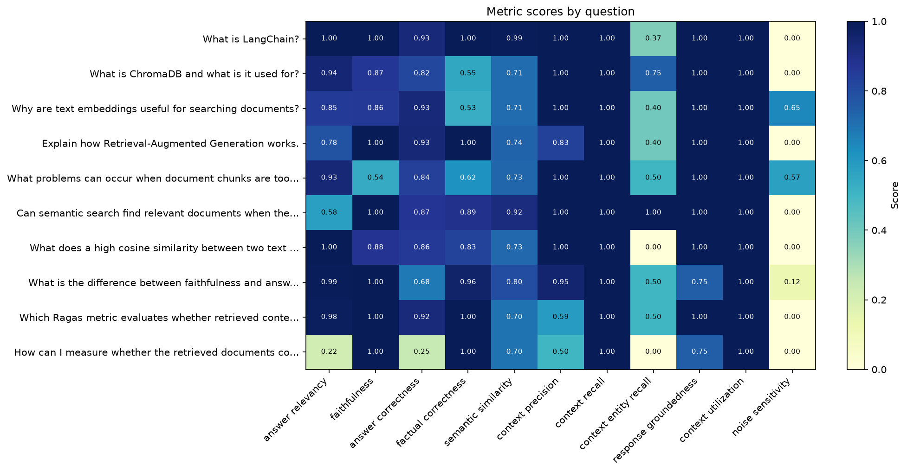
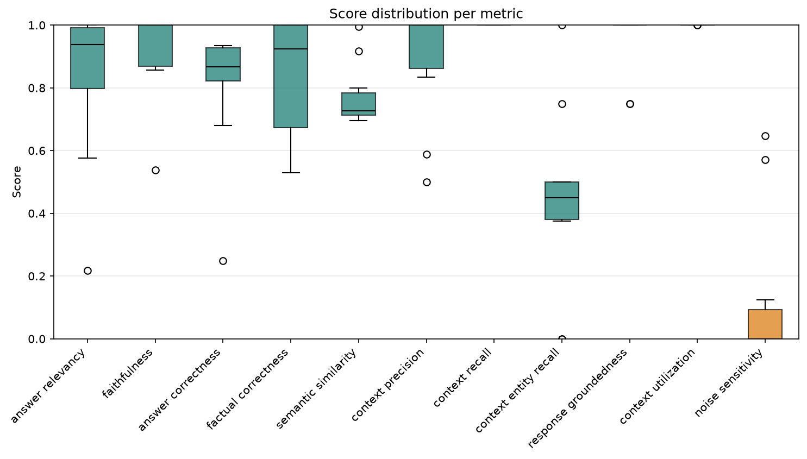

# RAGAS Evaluation Project

A small, end-to-end example of evaluating a Retrieval-Augmented Generation (RAG) pipeline with [RAGAS](https://docs.ragas.io/).

It indexes PDF and text files from a folder, answers questions using a hosted LLM with retrieved context, and scores the answers with eleven RAGAS metrics.

## What it does

```
documents/*.pdf, *.txt
        │
        ▼
recursive text splitting ──> embeddings ──> ChromaDB
                                                │
question ──> top-5 retrieval ───────────────────┘
                    │
                    ▼
           LLM answer (NVIDIA NIM)
                    │
                    ▼
       RAGAS metrics ──> ragas_results.csv ──> plots/*.png
```

For every question the project:

1. Recursively finds `.pdf` and `.txt` files in `documents/`.
2. Extracts text page by page from PDFs and splits everything with `RecursiveCharacterTextSplitter`.
3. Embeds the chunks with `all-MiniLM-L6-v2`.
4. Stores them in a local ChromaDB collection with source, page, and chunk metadata.
5. Retrieves the 5 most similar chunks.
6. Generates an answer from the retrieved context.
7. Scores the result, writes a CSV, and generates charts.

## Requirements

- Python **3.13+**
- An [NVIDIA API key](https://build.nvidia.com/)
- ~1 GB of free disk space (dependencies) plus ~90 MB for the embedding model

## Setup

Clone the repository, then install the dependencies.

Using `uv` (recommended — resolves from `uv.lock`):

```bash
uv sync
```

Using `pip`:

```bash
python -m venv .venv
.venv\Scripts\activate        # Windows
source .venv/bin/activate     # macOS / Linux
pip install .
```

Create your `.env` file from the template and add your key:

```bash
cp .env.example .env
```

```dotenv
NVIDIA_API_KEY=your-nvidia-api-key-here
```

## Add documents

Put `.pdf` and `.txt` files anywhere under `documents/`; subdirectories are scanned recursively. A small sample corpus is included so the project runs out of the box. Replace it with your own files (or add more) when you are ready.

```text
documents/
├── sample_corpus.txt
├── handbook.pdf
└── policies/
    └── leave-policy.txt
```

Only text-based PDFs are supported. Scanned image-only PDFs need OCR before ingestion.

Chunking defaults to 800 characters with 150 characters of overlap. Override them when needed:

```bash
uv run ingest.py --chunk-size 1200 --chunk-overlap 200
```

## Evaluation dataset

Questions and reference answers live in `eval_dataset.json`:

```json
[
  {
    "question": "What is LangChain?",
    "reference": "LangChain is an open-source framework ..."
  }
]
```

Add or edit entries to evaluate different questions. The cache prunes questions that are no longer present, and scores are invalidated automatically when a reference answer changes.

## Run

`eval.py` rebuilds the ChromaDB collection from `documents/` on every run:

```bash
uv run eval.py
```

To rebuild the index without running the evaluation:

```bash
uv run ingest.py
```

Use `--append` to keep existing chunks and upsert new ones by their stable IDs:

```bash
uv run ingest.py --append
```

Or, with the venv activated:

```bash
python eval.py
python ingest.py
```

The first run downloads the embedding model to `models/checkpoints/` (about 90 MB) and is slower than subsequent runs.

## Web UI

A small Streamlit app is included for interactive testing:

```bash
uv run streamlit run app.py
```

The UI lets you:

- Upload PDF or text files and rebuild the ChromaDB index with custom chunk settings.
- Ask any question about the indexed documents.
- Optionally provide a reference answer to unlock reference-based metrics.
- Inspect the generated answer, retrieved contexts, and per-metric scores.

Metrics that need a reference answer are hidden until you provide one. For the full dataset, CSV output, and plots, run `uv run eval.py`.

The UI disables Streamlit's file watcher in `.streamlit/config.toml` to avoid a watcher bug where Transformers probes optional `torchvision` modules.

## Development

```bash
uv sync

uv run ruff check .
uv run ruff format --check .
uv run pytest
```

The tests use fake models and temporary directories, so they do not need an API key or a model download. CI runs linting, formatting checks, and the test suite on every push and pull request (`.github/workflows/ci.yml`).

## Output

- `ragas_results.csv` — one row per question with the answer, retrieved contexts, reference answer, and metric scores.
- `plots/` — charts generated after the CSV is written (created at runtime):
  - `average_metric_scores.png` — average score per metric.
  - `metric_scores_by_question.png` — heatmap of every question against every metric.
  - `metric_score_distributions.png` — box plot of each metric's spread.
- `eval_cache.json` — intermediate cache so a run can resume without paying for the same LLM calls twice.
- `db/chroma_db/` — the persistent ChromaDB store.

The generated outputs above are ignored by git. The example charts in `assets/` are committed so they render in this README; running the evaluation overwrites only `plots/`, not `assets/`.

## Example plots

These were generated from the current sample run. Your own scores will differ, but the layout is the same.

### Average score per metric



### Metric scores by question



### Score distribution per metric



## Metrics

The evaluation in `eval.py` uses the RAGAS `collections` metrics:

| Metric | What it checks |
| --- | --- |
| `answer_relevancy` | Does the answer actually address the question? |
| `faithfulness` | Is the answer supported by the retrieved context? |
| `answer_correctness` | Does the answer agree with the reference (facts + meaning)? |
| `factual_correctness` | How much factual overlap is there with the reference? |
| `semantic_similarity` | Embedding similarity between the answer and reference. |
| `context_precision` | Is the retrieved context relevant? |
| `context_recall` | Does the context cover what the reference answer needs? |
| `context_entity_recall` | Are the reference's entities present in the context? |
| `response_groundedness` | Is the response grounded in the retrieved context? |
| `context_utilization` | Was the useful retrieved context actually used? |
| `noise_sensitivity` | How often the answer is misled by noise (lower is better). |

All scores are floats between 0 and 1. Every metric except `noise_sensitivity` is better when higher.

Adding a metric is a single entry in `build_metrics()` in `eval.py`: provide the scorer and the sample fields it needs (`user_input`, `response`, `retrieved_contexts`, `reference`). The pipeline handles inputs, caching, CSV columns, averages, and plots automatically.

> Each LLM-based metric adds API calls per question. Remove entries from `build_metrics()` if you want a cheaper run.

## Project layout

```
.
├── documents/              # Input .pdf and .txt files (sample corpus included)
├── eval_dataset.json       # Questions and reference answers for evaluation
├── eval.py                 # Main pipeline + RAGAS evaluation
├── app.py                  # Streamlit UI for indexing and single-question evaluation
├── .streamlit/config.toml  # Streamlit settings (disables the file watcher)
├── ingest.py               # CLI for building the ChromaDB index
├── document_loader.py      # Recursive PDF/TXT loading and chunking
├── plots.py                # Chart generation from the results DataFrame
├── assets/                 # Example charts embedded in this README
├── llm.py                  # NVIDIA client, retry logic, RAGAS LLM wrapper
├── embeddings.py           # Ragas adapter around the shared SentenceTransformer
├── cache.py                # JSON cache load/save helpers
├── db/
│   ├── chroma.py           # ChromaDB wrapper (upsert, search, delete, clear)
│   └── embedding_func.py   # Chroma embedding function
├── models/
│   └── model.py            # Downloads/loads all-MiniLM-L6-v2
├── tests/                  # Pytest suite with fake models and temp DBs
├── .github/workflows/ci.yml # Lint, format check, and tests
├── pyproject.toml          # Project metadata, dependencies, and tool config
└── uv.lock                 # Fully resolved dependency lockfile
```

## How it works

**Embeddings are shared.** `models/model.py` loads one `SentenceTransformer`, and both ChromaDB (`db/embedding_func.py`) and RAGAS (`embeddings.py`) use it. This keeps retrieval and evaluation embeddings consistent.

**The LLM client is async and retries.** `llm.py` talks to the NVIDIA OpenAI-compatible endpoint and retries rate-limit, timeout, connection, and 5xx errors with exponential backoff, honoring the `retry-after` header.

**Chunking is recursive and metadata-aware.** `document_loader.py` extracts text page by page from PDFs, reads UTF-8 text files, and uses LangChain's `RecursiveCharacterTextSplitter`. Every chunk keeps its relative source path, PDF page number, and chunk index. Stable IDs are derived from the source, page, and chunk index, so re-ingesting the same file updates existing chunks instead of duplicating them.

**Caching is per question and per metric.** `eval.py` stores the answer, retrieved contexts, reference, and each metric score in `eval_cache.json`. Cached metrics are printed as `cached` and skipped, so adding a metric only scores that metric instead of redoing the whole run. Entries for questions no longer in `eval_dataset.json` are pruned automatically on load. Cached answers are reused only when freshly retrieved contexts match; otherwise the answer and its scores are regenerated. Every computed answer and metric is saved immediately, so an interrupted run keeps its progress. If the answer or reference for a question changes, its old scores are discarded automatically. To force a full re-evaluation, delete `eval_cache.json`.

**Plots are generated after the CSV.** `plots.py` creates the `plots/` directory if it does not exist, then writes the average-score bar chart, the question-by-metric heatmap, and the score-distribution box plot. Runtime output goes to `plots/` and is overwritten on each run; the copies in `assets/` are kept for this README.

**The database is rebuilt on each evaluation run.** `eval.py` replaces the collection contents with chunks from the current `documents/` folder, so the CSV always reflects the current files.

## Troubleshooting

- **`ValueError: NVIDIA_API_KEY is missing from your .env file`** — create `.env` from `.env.example` and add your key.
- **`No .pdf or .txt files found`** — add files under `documents/` or pass `--documents-dir`.
- **`No readable text found`** — the PDFs may be scanned images, or the text files may be empty. Run OCR first for image-only PDFs.
- **First run seems stuck** — it is downloading the embedding model. Later runs load it from `models/checkpoints/`.
- **Frequent rate limits** — lower `max_attempts` or increase `base_wait` in `llm.py:53`, or use a different model.
- **Poor retrieval** — tune `--chunk-size` and `--chunk-overlap` for your documents, then re-run `ingest.py` or `eval.py`.
- **Stale results** — delete `eval_cache.json` (and optionally `ragas_results.csv`) and run again.

## Notes

- `langchain-community` is pinned to `0.3.31` because RAGAS 0.4.3 imports a module that newer versions removed.
- `models/checkpoints/`, `.venv/`, `.env`, UI uploads, and the generated evaluation files (`plots/`, CSV, cache, ChromaDB) are git-ignored. The example images in `assets/` are intentionally committed.
